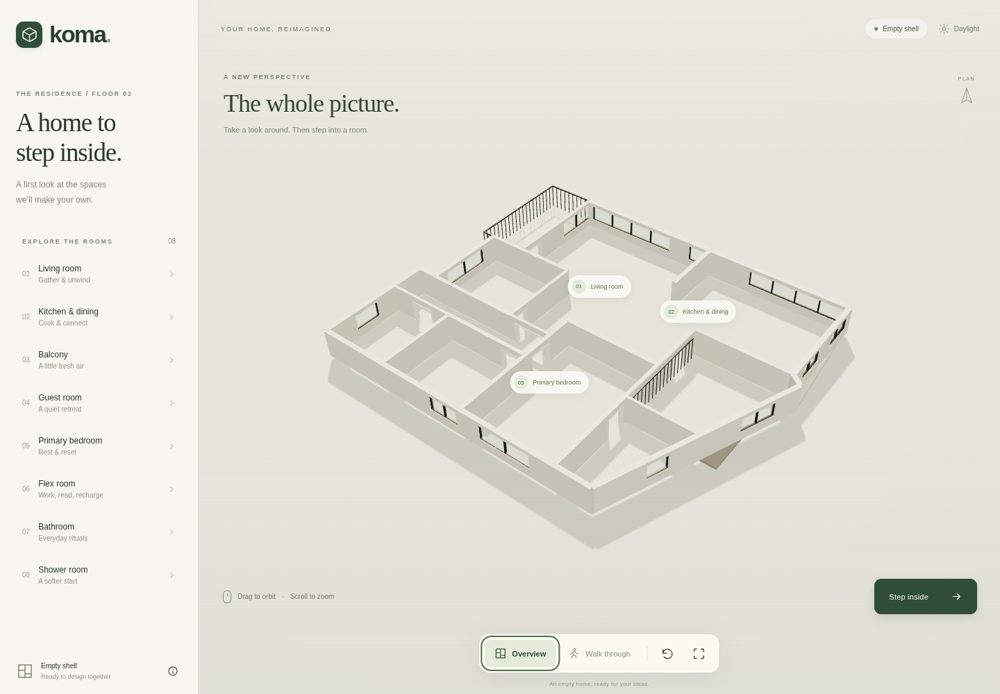
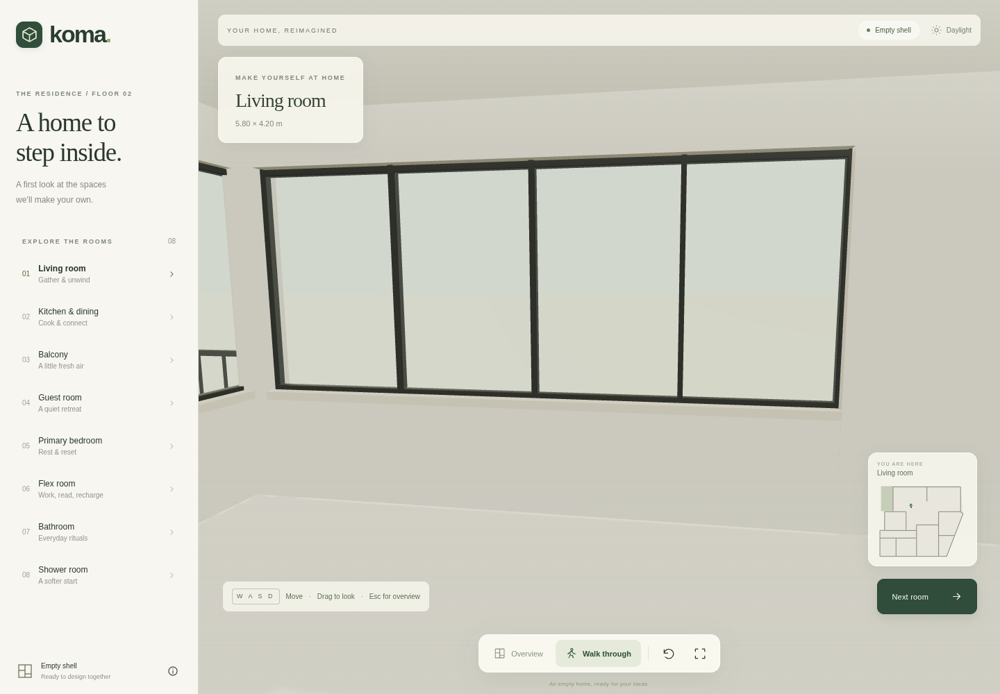

# Koma — a home to explore

A view-only Three.js walkthrough reconstructed from `koma-b.pdf`. Visitors can walk, look around, jump between eight rooms, and orbit a cutaway overview. The current model is an empty architectural shell, ready to design from the real home. All design changes are maintained in the repository; there are no visitor editing controls or accounts.





## Run

Requires Node.js 24 and npm. In the repository directory:

```sh
npm ci
npm run dev
```

Build with `npm run build`; serve the result with `npm run preview`. All geometry is generated locally: the published site has no CDN, font, analytics, login, or API dependency.

## Controls

- **Overview:** drag to orbit, scroll/pinch to zoom, right-drag/two-finger drag to pan.
- **Walk:** WASD or arrow keys to move; drag the view to look. Shift walks faster.
- **Phone/tablet:** drag the joystick to move; drag the scene to look. Open **Rooms** for shortcuts.
- **Escape:** return to overview. Reset returns to the current room's starting view.
- Share `#room=living`, `#room=bedroom`, etc. for a particular room.

## Model and assumptions

`src/plan.js` contains the traced footprint, walls, openings, room destinations, and collision geometry. The 1,530 cm overall plan dimension calibrates the reference image to metres. `src/world.js` builds the empty architectural shell with neutral placeholder materials and daylight. Static geometry is batched for mobile performance.

- The ceiling height is assumed to be **2.80 m**, eye height **1.62 m**.
- Window sill/head heights and some openings are inferred. Verify them on site.
- The owner confirmed the living/kitchen divider's outlined extension was never built. The model retains the solid section shown on the plan (approximately 2.65 m long); its exact length still needs a site measurement.
- All added furniture, cabinetry, appliances, bathroom fittings, wall decor, plants, rugs, and light fixtures have been removed at the owner’s request. The orange-X unit shown beside the kitchen/living divider in the plan is intentionally absent.
- Plain floor/wall surfaces and window/door frames are placeholders; actual finishes and room uses still need confirmation from the real home.
- Stairs are a visual placeholder. Walking stays on the supplied floor.
- The “area = 16.0” annotation is not used as an area measurement because its context is unclear.
- This is an approximate visualisation, not a construction drawing or a measured survey.
- The original PDF and personal photos/videos are not bundled into the public build.

## Check

```sh
npm test
npx playwright install chromium
npm run test:e2e
```

If using an existing system Chromium: `CHROMIUM_PATH=/usr/bin/chromium npm run test:e2e`.
The browser tests exercise the production build under `/interiordesign/`, all room destinations, continuous walking routes, desktop look/movement, mobile touch navigation, and direct room links. Test screenshots are saved under `test-results/`.

## Publish

The GitHub Actions workflow builds, tests, and deploys pushes to `main` with GitHub Pages. In **Repository Settings → Pages**, set **Source → GitHub Actions** once. This requires Pages to be available for the repository's visibility/account plan.

Expected address after successful deployment: `https://janis97-droid.github.io/interiordesign/`.

If Pages needs to be enabled by an authenticated administrator:

```sh
gh api --method POST repos/janis97-droid/interiordesign/pages -f build_type=workflow
```

This creates a Pages site; for an existing site, inspect it first and update its build type if needed. A pushed commit or saved environment draft alone does not mean the site is live.

## Further design work

Use the existing checkout (cloud tasks are already isolated; no additional worktree is necessary). Change room geometry in `src/plan.js`, then update the shell or add owner-requested furnishings in `src/world.js`. Keep visitor controls view-only. Re-run the navigation tests when moving walls, openings, room destinations, or furniture.
